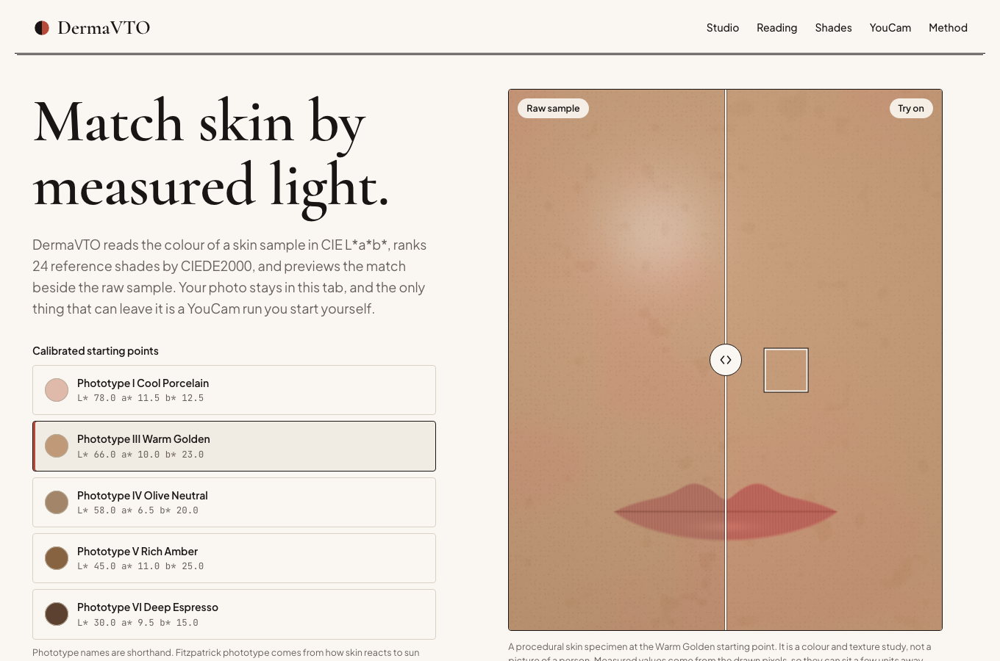
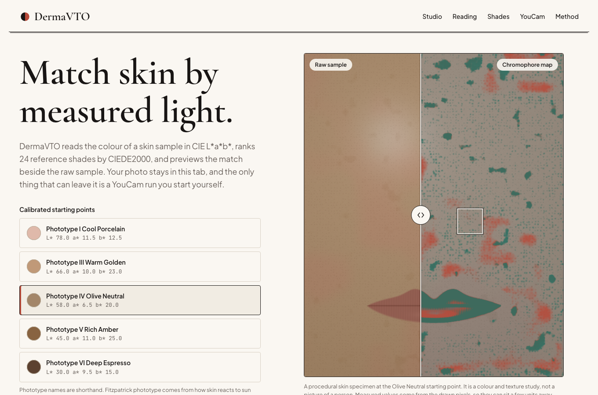

# DermaVTO

Live studio at https://aariv.me/dermavto/
Source code at https://github.com/draarivpatel-ui/dermavto

DermaVTO reads the colour of a skin sample, places it on the Individual Typology Angle scale, ranks 24 reference shades by CIEDE2000, and previews foundation and lip colour beside the raw sample. It also builds the exact request bodies for Perfect Corp's YouCam skin analysis and makeup try on endpoints, reads their responses back into a routine, and can run both live with your own API key.

It was built for the YouCam API Skin AI and eCommerce VTO Hackathon. It is an independent project and is not made or endorsed by Perfect Corp.



## What it does

- **Colour science.** Exact sRGB to linear light to CIE XYZ (D65) to L*a*b* conversion, the Individual Typology Angle with its six bands, and the full CIEDE2000 formula from Sharma, Wu and Dalal (2005).
- **Skin patch analysis.** From a block of pixels it measures mean L*a*b*, an erythema proxy, a melanin proxy, redness coverage, Laplacian texture roughness, pore minima and specular shine. Every index is an optical approximation from three colour channels.
- **Split try on studio.** Drag the divider over a procedural skin specimen, or over a photo from your device. The right side shows either a chromophore map (erythema in carmine, melanin in sage) or foundation and lip colour applied in L*a*b*.
- **Shade ranking.** 13 foundation, 6 concealer and 5 lip reference swatches ranked by CIEDE2000 to a target taken from your sample, with the top three marked on an ITA plot and an undertone compass.
- **YouCam tools.** A request builder with the same validation the API applies (HD and SD actions cannot be mixed, public https links only, integer intensities from 0 to 100), a response inspector that reads both the `format=json` response and a `score_info.json`, and a routine and shade receipt.
- **Live run.** Optional. Paste your own YouCam key, tick the consent box, and the page calls the API straight from your browser.



## Privacy

Fonts, scripts and styles all load from this site. A photo is read with the browser's file API, drawn to a canvas and thrown away when the tab closes. The only code that can reach the network is `youcam-live.js`, and it runs only after you press Run live. A link run sends the link. An upload run sends the photo. Your key is kept in memory for that run, is never stored, and goes nowhere except Perfect Corp. A test in the suite checks that no other file contains a network call.

## Run it

It is plain HTML, CSS and JavaScript with no build step and no dependencies.

```bash
git clone https://github.com/draarivpatel-ui/dermavto.git
cd dermavto
python3 -m http.server 8000
```

Then open http://localhost:8000. Run the tests with Node 18 or newer.

```bash
npm test
```

## YouCam compatibility

The request builder and the live client follow the OpenAPI files Perfect Corp publishes, checked on 25 October 2026.

| Item | Value used |
| :--- | :--- |
| Host | `https://yce-api-01.makeupar.com` |
| Skin analysis | `POST /s2s/v2.0/task/skin-analysis`, then `GET` the same path plus `/{task_id}` |
| Makeup try on | `POST /s2s/v2.0/task/makeup-vto`, then `GET` the same path plus `/{task_id}` |
| File upload | `POST /s2s/v2.0/file`, then `PUT` to the signed URL it returns |
| Skin analysis body | `src_file_url` or `src_file_id`, `dst_actions`, `format` |
| Makeup try on body | `src_file_url` or `src_file_id`, `version` (the effect specification, `1.0`), `effects` |
| Effects built | `foundation`, `concealer` and `lip_color`, with the palette fields the spec marks required |

The paths are `v2.0`. The `1.0` that appears in the makeup documentation is the version of the effect specification, which goes in the `version` field of the body. Scores run from 1 to 100 where higher is better looking skin, and `raw_score` is shown before `ui_score` because the documentation says `ui_score` is adjusted upward on purpose.

### What has and has not been checked against the real service

- Checked against the live host. The browser preflight request is answered with `access-control-allow-origin: *`, so a page can call the API directly, and a request with an invalid key returns HTTP 401 `InvalidApiKey`, which the page shows as "YouCam did not recognise this API key."
- Checked with a scripted transport only. The full flow of upload, task creation, polling, success, error and timeout is covered by unit tests that replace the network. It has not been run end to end with a valid key.
- Not checked. Whether the signed upload address accepts a cross origin `PUT` from a browser is unknown, so the upload path may be blocked by that storage service even with a valid key. Link runs do not depend on it. The lip shape name `original` comes from the documentation's own examples, and the full list of shape names was not available.

## Honesty notes

- ITA bands follow the thresholds in the literature and are used as colour descriptions, not as a measure of anything medical. ITA and Fitzpatrick phototype are different scales. The preset names that say "Phototype" are shorthand.
- Undertone (Cool, Neutral, Warm, Olive) has no published standard. The zones here come from the ratio of a* to b*, are tuned for stability, and are labelled as a heuristic everywhere they appear.
- The concealer target (L* lifted by 3) and the lip target (darker and redder than the sample) are styling heuristics, not measurements.
- The 24 reference swatches were specified for this project in L*a*b* and stored as hex. They are generic names, not any brand's products.
- The skin specimen is a texture study with shading, pores, mottled redness, pigment spots, a highlight and a lip shape. It is not a picture of a person. On a photo, foundation uses a colour window for skin and not face tracking, and lips are coloured only on the specimen.
- All numbers here are cosmetic and educational colour measurements. They are not a clinical assessment and cannot replace a dermatologist.

## Tests

`npm test` runs the suite with `node --test`. It covers the colour maths (including all 34 published CIEDE2000 pairs to four decimals), ITA bands and boundaries, the undertone heuristic, swatch ranking, seeded specimen generation, patch analysis, try on rendering, the YouCam payload builder and normalizer, the live client against a scripted network, the page's markup and styles, and `app.js` running against a stand-in DOM.

## References

- G. Sharma, W. Wu and E. N. Dalal, "The CIEDE2000 color-difference formula", Color Research and Application 30(1), 2005. Test data from https://www.hajim.rochester.edu/ece/sites/gsharma/ciede2000/
- S. Del Bino, E. Duval and F. Bernerd, "Clinical and Biological Characterization of Skin Pigmentation Diversity and Its Consequences on UV Impact", International Journal of Molecular Sciences 19(9), 2018, which tabulates the ITA bands attributed to Chardon et al. (1991).
- Perfect Corp YouCam API documentation and OpenAPI files, https://docs.perfectcorp.com/

## Licence

MIT. See `LICENSE`. The fonts in `fonts/` are under the SIL Open Font License, see `fonts/LICENSES.txt`.
